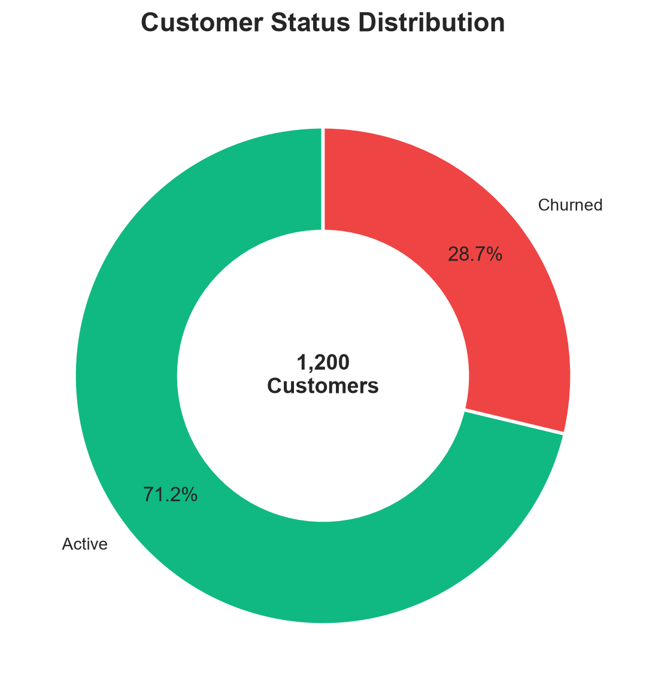
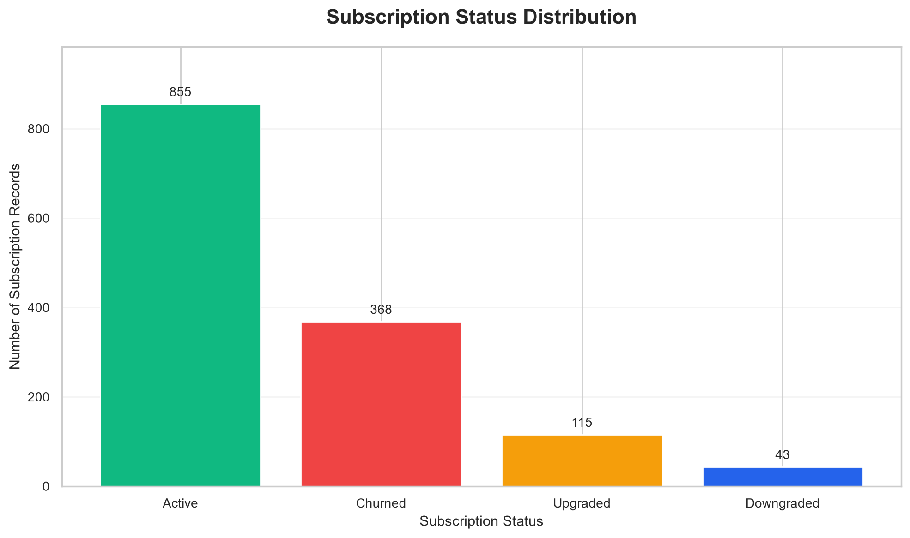
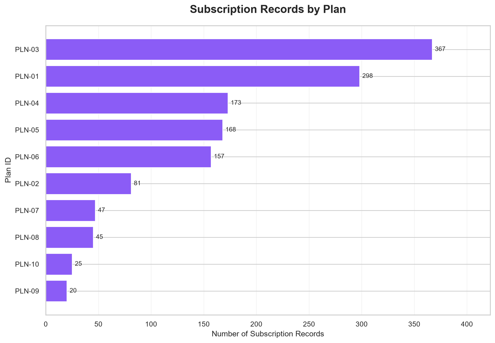
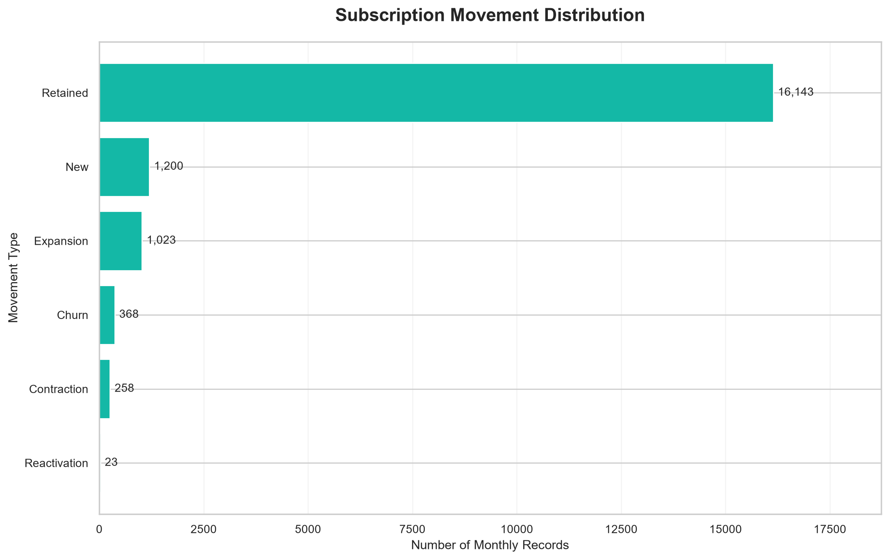
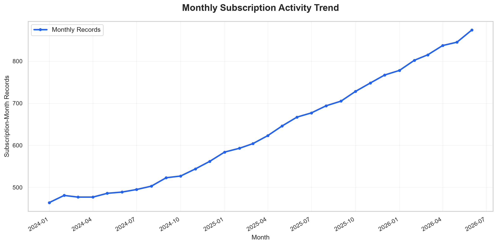
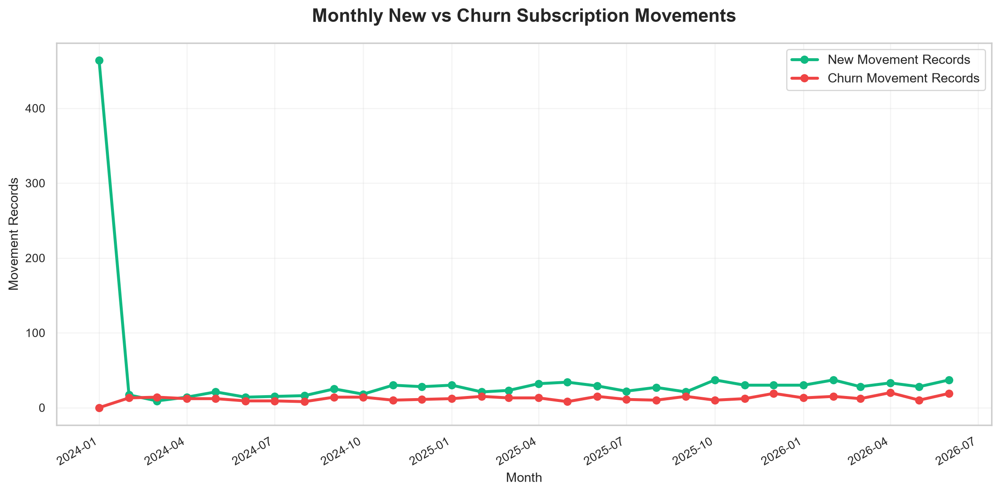

# SaaS Revenue & Subscription Analytics
## Exploratory Data Analysis — Business Findings

### 1. Project Overview

This report summarizes initial exploratory analysis of five
SaaS datasets: plans, customers, subscriptions,
subscription_months, and invoices.

The analysis focuses on customer status, subscription
distribution, plan distribution, and monthly subscription
movement patterns.

### 2. Dataset Summary

| Metric | Value |
|---|---:|
| Customers | 1,200 |
| Subscription records | 1,381 |
| Subscription-month records | 19,015 |
| Invoice records | 11,257 |
| Available plans | 10 |

### 3. Customer Overview

- Active customers: 855
- Churned customers: 345
- Active customer share: 71.25%

These are customer status counts, not monthly churn rates.

### 4. Subscription Plan Findings

- Plan with most subscription records:
  PLN-03 (367 records)
- Plan with fewest subscription records:
  PLN-09 (20 records)

These counts represent subscription records,
not necessarily current active subscribers.

### 5. Monthly Activity Findings

- Highest monthly activity:
  2026-06
  (874 records)
- Lowest monthly activity:
  2024-01
  (464 records)
- Month with most New movement records:
  2024-01
  (464 records)
- Month with most Churn movement records:
  2026-04
  (20 records)

Monthly activity represents subscription-month
record coverage, not monthly revenue.

### 6. Subscription Movement Distribution

| Movement Type | Record Count |
|---|---:|
| Retained | 16,143 |
| New | 1,200 |
| Expansion | 1,023 |
| Churn | 368 |
| Contraction | 258 |
| Reactivation | 23 |

Movement counts are event-category records,
not revenue amounts.

### 7. Visualizations

### 8. Business Interpretation

1. The customer base contains both active and churned customers,
   providing a foundation for lifecycle analysis.
2. Subscription records exceed customer records, so subscription
   counts must not be treated as unique customer counts.
3. Subscription movement records show multiple types of
   lifecycle activity, including expansion and contraction.
4. Monthly movement patterns can help identify periods
   requiring deeper investigation.

### 9. Analysis Limitations

- This report does not calculate MRR, ARR, retention rate,
  monthly churn rate, or customer lifetime value.
- Subscription-month record counts are not equivalent
  to active paying customer counts.
- Observed associations do not establish causation.
- The source dataset is synthetic, so findings should
  not be presented as real-company performance.

### 10. Next Analysis

The next phase will focus on validated SaaS revenue KPIs,
MRR movements, churn, and retention analysis.
