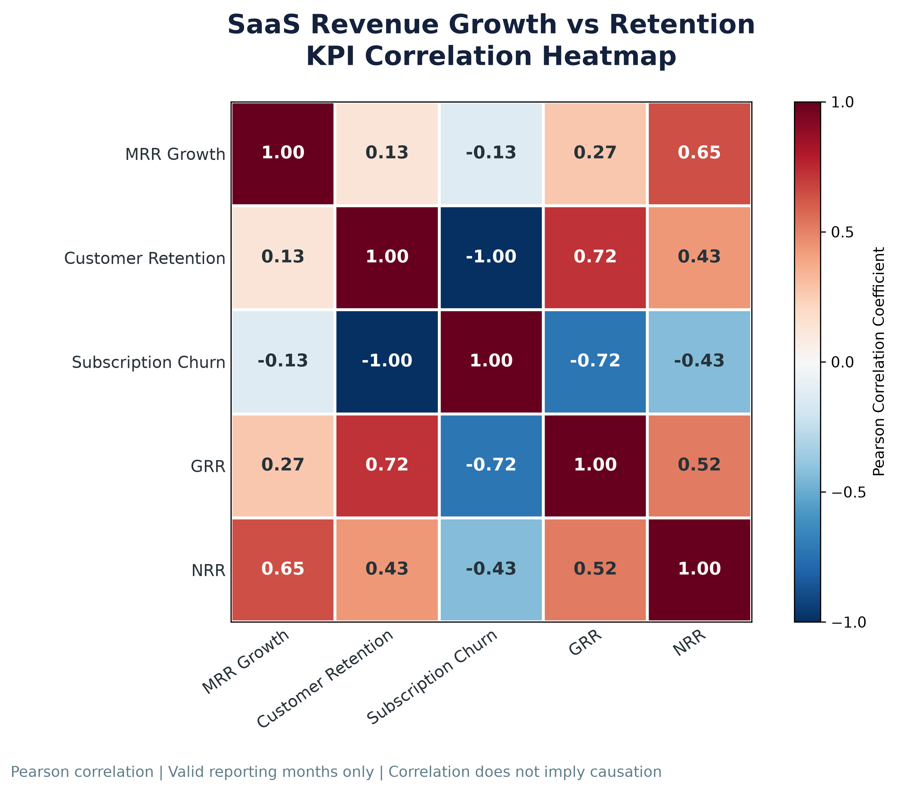

# SaaS Revenue Growth & Retention Business Findings

## 1. Analysis Overview

This analysis evaluates the relationship between monthly
recurring revenue growth and customer/subscription retention
performance.

- Reporting months analyzed: **29**
- Dataset: SaaS Monthly KPI Summary
- Analysis: Descriptive KPI analysis and Pearson correlation
- First reporting month excluded from comparative analysis
  because its opening-base retention metrics are undefined.

## 2. Revenue Growth Performance

- Average monthly MRR growth: **4.09%**
- Months with positive MRR growth: **29**
- Months with negative MRR growth: **0**

These results describe the direction and average rate of
monthly recurring revenue changes during valid reporting periods.

## 3. Customer & Subscription Retention

- Average monthly customer retention: **97.89%**
- Average monthly subscription churn: **2.11%**

Customer retention measures the proportion of opening paying
customers retained during each reporting period.

Subscription churn measures the proportion of opening paid
subscriptions that churned during each reporting period.

## 4. Revenue Retention Performance

- Average monthly GRR: **98.58%**
- Average monthly NRR: **100.99%**
- Months with net revenue expansion (NRR > 100%): **22**
- Months with net revenue loss (NRR < 100%): **7**

GRR measures recurring revenue retention without expansion.

NRR incorporates expansion, contraction, and churn
within the existing revenue base.

## 5. Revenue Growth vs Retention Correlations

- **Customer_Retention_Rate_Pct:** Pearson r = 0.1303; positive association; very weak linear relationship.
- **Subscription_Churn_Rate_Pct:** Pearson r = -0.1303; negative association; very weak linear relationship.
- **GRR_Pct:** Pearson r = 0.2658; positive association; weak linear relationship.
- **NRR_Pct:** Pearson r = 0.6457; positive association; strong linear relationship.

### Strongest Observed Association

The strongest observed linear association with monthly MRR growth was **NRR_Pct**, with Pearson r = **0.6457**.

Correlation indicates the direction and strength of
a linear association. It does not establish causation.

Some revenue metrics share underlying components,
so their correlation may partly reflect mathematical overlap.

## 6. Business Implications

1. Monitor MRR growth alongside customer and subscription
   retention rather than evaluating revenue growth alone.
2. Track churn to identify months with greater subscription
   losses relative to the opening subscription base.
3. Compare GRR and NRR to understand the contribution of
   expansion revenue to existing-customer revenue retention.
4. Investigate months with negative MRR growth or NRR below
   100% before recommending corrective business actions.
5. Treat correlation findings as exploratory evidence,
   not proof of business drivers.

## 7. Visualization

## 8. Methodology & Limitations

- All percentage averages are arithmetic averages of
  monthly KPI percentages, not weighted overall rates.
- The first reporting month was excluded from comparative
  analysis because its retention denominators were zero.
- Pearson correlation measures linear association only.
- Correlation does not imply causation.
- The dataset is synthetic, so findings should not be
  generalized to real SaaS companies without validation.
- Business recommendations require additional investigation
  of customer segments, revenue movements, and churn causes.

## 9. Analysis Status

- Revenue Growth KPI Analysis: Completed
- Retention KPI Analysis: Completed
- Pearson Correlation Analysis: Completed
- Correlation Heatmap: Completed
- Business Findings Report: Completed
