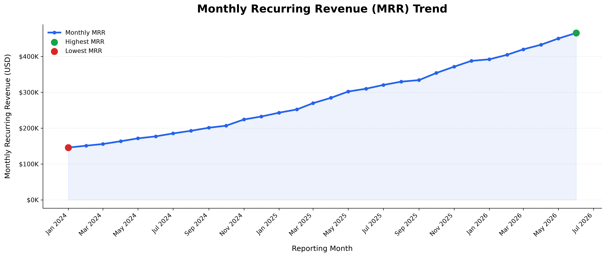
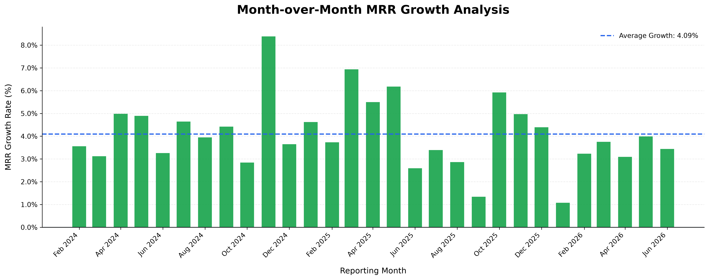
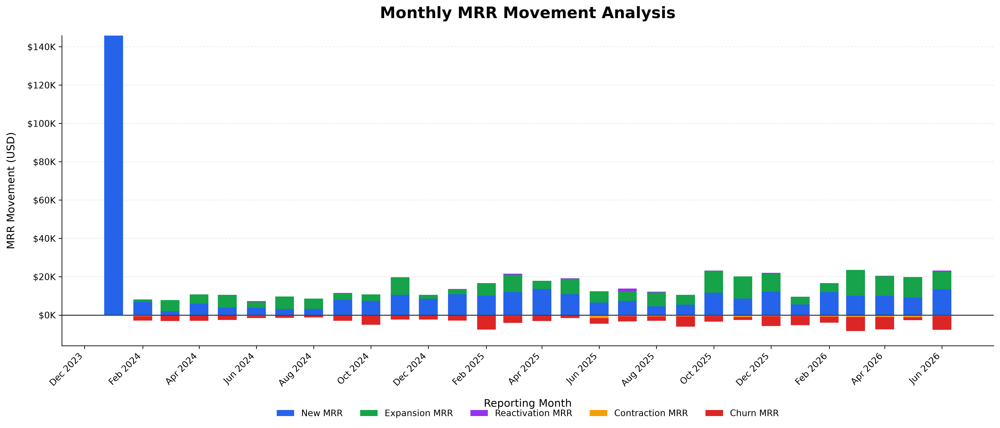
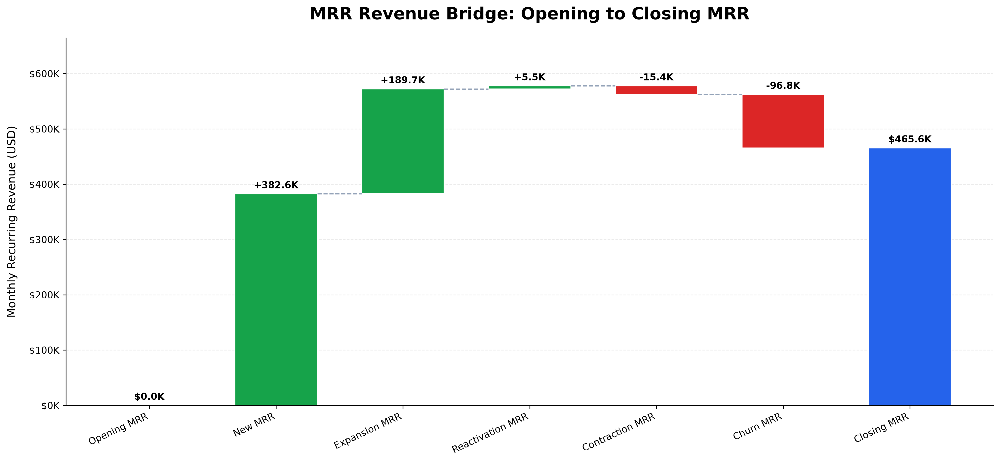

# SaaS Revenue Trend & Subscription Analytics
## Revenue Trend Business Findings Report

### 1. Executive Summary

This report presents an analysis of Monthly Recurring Revenue
(MRR), month-over-month growth, revenue movements, and revenue
bridge reconciliation using the project's SaaS subscription data.

**Reporting Period:** Jan 2024 to Jun 2026

**Key Performance Indicators**

| KPI | Value |
|---|---|
| First Month Closing MRR | $145,853.24 |
| Last Month Closing MRR | $465,561.26 |
| First-to-Last Closing MRR Change | $319,708.02 |
| First-to-Last Closing MRR Change (%) | 219.20% |
| Average Monthly Growth | 4.09% |
| Median Monthly Growth | 3.75% |

### 2. Monthly Recurring Revenue Trend

**Highest MRR Month:** Jun 2026

**Highest Monthly MRR:** $465,561.26

**Lowest MRR Month:** Jan 2024

**Lowest Monthly MRR:** $145,853.24

### 3. Month-over-Month MRR Growth

| Growth Metric | Value |
|---|---|
| Positive Growth Months | 29 |
| Negative Growth Months | 0 |
| Zero Growth Months | 0 |
| Highest Growth Month | Nov 2024 |
| Highest MoM Growth | 8.38% |
| Lowest Growth Month | Jan 2026 |
| Lowest MoM Growth | 1.08% |

### 4. MRR Movement Analysis

The following figures represent cumulative MRR movements
across the reporting period, not total recognized revenue.

| Movement Component | Amount |
|---|---|
| New MRR | $382,591.78 |
| Expansion MRR | $189,736.59 |
| Reactivation MRR | $5,496.37 |
| Contraction MRR (Reduction) | $15,450.00 |
| Churn MRR (Reduction) | $96,813.48 |

### 5. MRR Revenue Bridge Analysis

| Revenue Bridge Metric | Value |
|---|---|
| Initial Opening MRR | $0.00 |
| Final Closing MRR | $465,561.26 |
| Overall Revenue Bridge Change | $465,561.26 |
| Revenue Bridge Reconciliation | PASS |

### 6. Key Business Observations

1. Monthly recurring revenue changed from
   $145,853.24 to
   $465,561.26
   between the first and last reporting months.

2. The highest recorded MRR occurred in
   Jun 2026, reaching
   $465,561.26.

3. The strongest month-over-month growth occurred in
   Nov 2024, with growth of
   8.38%.

4. The lowest month-over-month growth occurred in
   Jan 2026, at
   1.08%.

5. The revenue bridge reconciliation status is
   **PASS**.

### 7. Business Recommendations

- Monitor MRR growth trends and investigate months
  with unusually low or negative growth.
- Analyze churn and contraction drivers to identify
  opportunities for revenue retention.
- Evaluate successful acquisition and expansion
  strategies during strong growth months.
- Track MRR movement components and reconciliation
  regularly to maintain consistent reporting.

### 8. Data Sources and Validation

- Source: Project SaaS subscription dataset
- Monthly KPI source: `data/processed/SaaS_Monthly_KPI_Summary.csv`
- Business findings: `data/processed/SaaS_Revenue_Trend_Business_Findings.csv`
- Analysis notebook: `notebooks/06_Revenue_Trend_Analysis.ipynb`
- Validation: Monthly MRR growth, movement formulas,
  and revenue bridge reconciliation

**Note:** This project uses synthetic SaaS data.
Findings are illustrative and do not represent
an actual company's financial performance.
