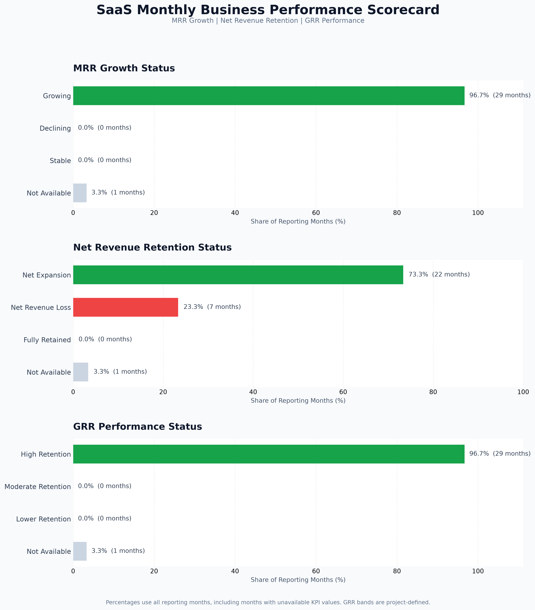

# SaaS Business Performance Scorecard Findings

## 1. Executive Summary

This report analyzes SaaS monthly business performance
using MRR growth, customer retention, subscription churn,
Gross Revenue Retention (GRR), and Net Revenue Retention (NRR).

- Total reporting months: **30**
- Months with complete KPI data: **29**
- Average monthly MRR growth: **4.09%**
- Average monthly customer retention: **97.89%**
- Average monthly subscription churn: **2.11%**
- Average monthly GRR: **98.58%**
- Average monthly NRR: **100.99%**

## 2. MRR Growth Performance

- Growing months: **29**
- Declining months: **0**
- Stable months: **0**
- Growth data unavailable: **1**

Highest MRR growth:
**2024-11**
(8.38%)

Lowest MRR growth:
**2026-01**
(1.08%)

## 3. Net Revenue Retention Performance

- Net expansion months: **22**
- Net revenue loss months: **7**
- Fully retained months: **0**
- NRR unavailable months: **1**

Highest NRR:
**2024-11**
(103.24%)

Lowest NRR:
**2024-02**
(98.88%)

## 4. GRR Performance

- High Retention (GRR >= 95%): **29**
- Moderate Retention (90% <= GRR < 95%): **0**
- Lower Retention (GRR < 90%): **0**
- Unavailable: **1**

GRR bands are project-defined descriptive categories,
not verified industry benchmarks.

## 5. Customer and Subscription Performance

- Average monthly customer retention:
  **97.89%**
- Average monthly subscription churn:
  **2.11%**

Customer retention and subscription churn are based on
different populations and are not complementary metrics.

## 6. Business Recommendations

1. Investigate months with negative MRR growth.
2. Review contraction and churn during months with NRR below 100%.
3. Compare customer retention and subscription churn trends.
4. Examine months classified as Lower Retention.
5. Use customer segment analysis before recommending
   operational changes.

## 7. Scorecard Visualization

## 8. Methodology and Limitations

- Monthly KPI averages are arithmetic means.
- Category counts include unavailable reporting periods.
- First-month retention rates are undefined because
  opening denominators are zero.
- GRR categories are project-defined.
- The dataset is synthetic.
- Descriptive patterns do not establish causation.

## 9. Analysis Status

- Scorecard Preparation: Completed
- Performance Category Analysis: Completed
- Scorecard Visualization: Completed
- Business Findings Report: Completed
