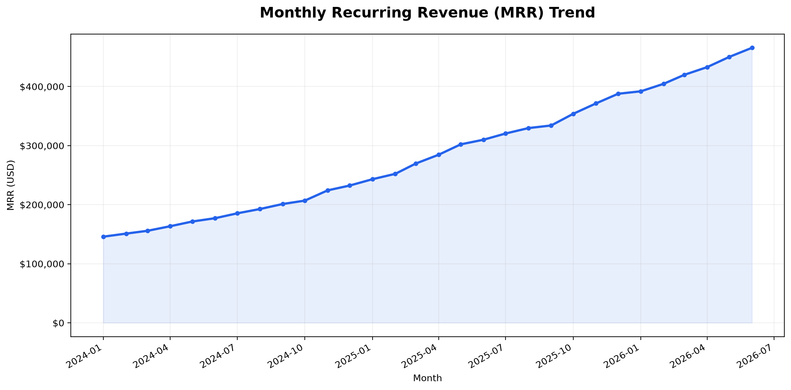
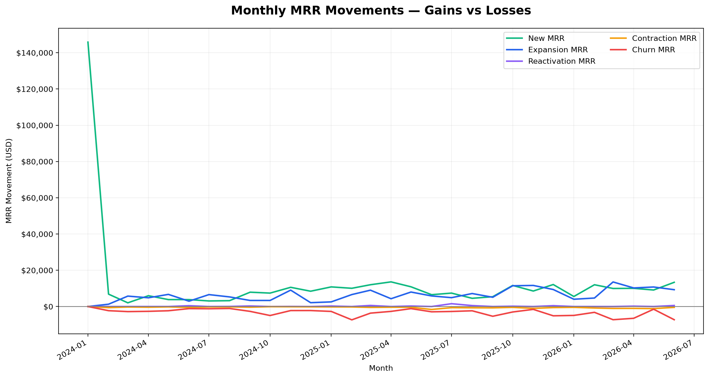
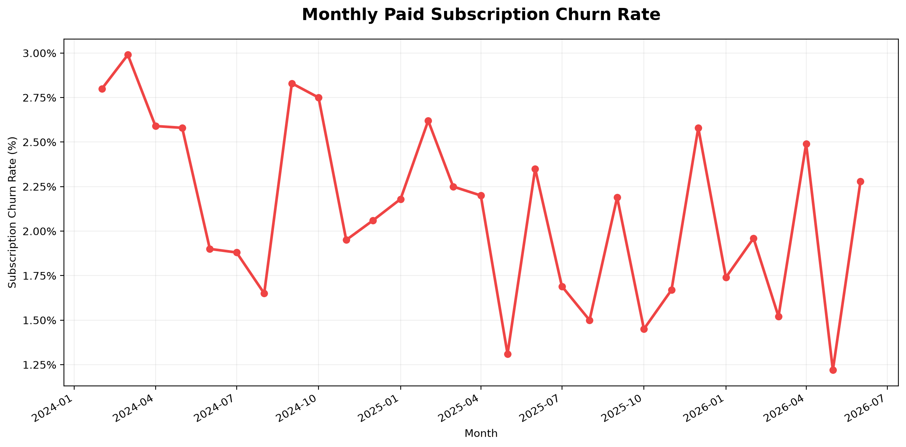
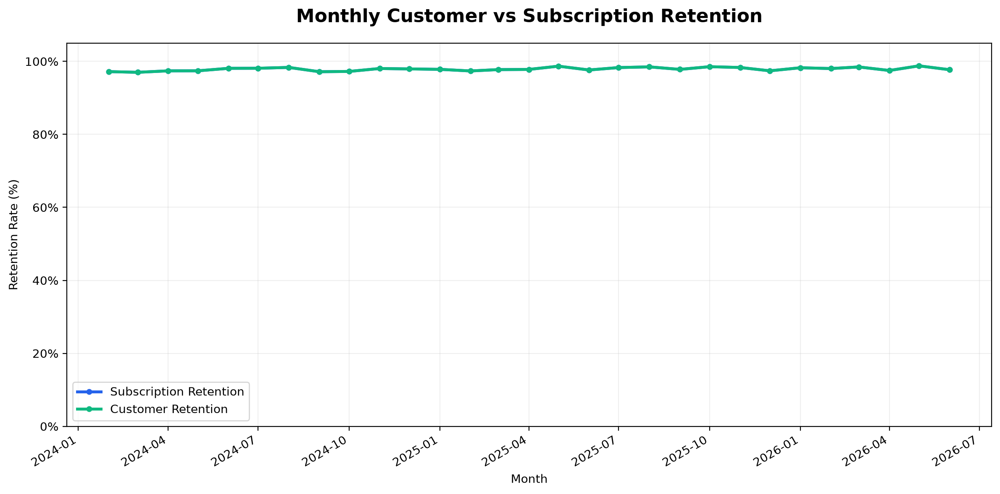
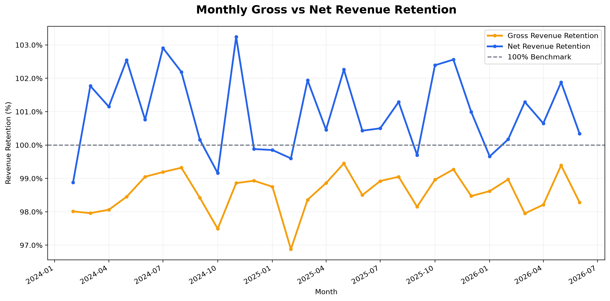

# SaaS Revenue & Subscription Analytics
## Revenue KPI Analysis — Business Findings

### 1. Executive Summary

This report presents validated monthly SaaS revenue,
churn, and retention KPIs calculated using Python
and Pandas.

The analysis covers 30 months.

### 2. Latest Monthly KPI Snapshot

**Reporting Month:** 2026-06

| KPI | Value |
|---|---:|
| Monthly Recurring Revenue | $465,561.26 |
| Gross Revenue Retention | 98.28% |
| Net Revenue Retention | 100.34% |
| Subscription Churn Rate | 2.28% |
| Subscription Retention Rate | 97.72% |
| Customer Retention Rate | 97.72% |

### 3. Key Revenue Findings

- Highest recorded MRR month:
  2026-06
- Highest recorded monthly MRR:
  $465,561.26
- Latest recorded monthly MRR:
  $465,561.26
- Months with NRR above 100%:
  22

### 4. Churn Findings

- Highest observed subscription churn-rate month:
  2024-03
- Highest observed subscription churn rate:
  2.99%

The subscription churn rate uses subscriptions with
positive previous MRR as the observed opening paid base.

### 5. Revenue Retention Interpretation

GRR measures recurring revenue retained from the
opening paid base after contraction and churn.

NRR also includes expansion from that opening base.

An NRR above 100% indicates that expansion exceeded
contraction and churn for that month, under the
implemented metric definition.

### 6. KPI Visualizations

### 7. Validation Summary

The Python KPI workflow completed the following checks:

- Monthly MRR aggregation reconciled with source data.
- MRR movement totals reconciled with source deltas.
- Revenue movements reconciled with monthly closing MRR.
- Churn and retention rates passed range and base checks.
- GRR and NRR passed revenue bridge and rate checks.
- The processed KPI summary was exported and verified.

### 8. Business Recommendations

1. Investigate months with elevated subscription churn.
2. Compare expansion revenue against contraction
   and churn losses.
3. Examine differences between customer retention
   and subscription retention.
4. Investigate periods where NRR falls below 100%.
5. Segment these metrics by customer cohorts and
   subscription plans in future analysis.

These are investigation priorities, not proven
causal explanations.

### 9. Limitations

- The source dataset is synthetic.
- Retention metrics depend on observed monthly records.
- Monthly MRR is a recurring revenue balance,
  not recognized revenue for the year.
- Customer churn events do not necessarily mean
  complete customer-level churn.
- Cohort analysis and customer acquisition cost
  are outside the scope of this report.

### 10. Processed Dataset

`data/processed/SaaS_Monthly_KPI_Summary.csv`
